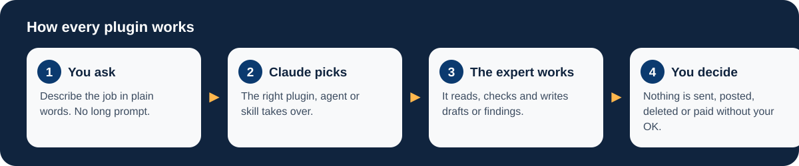
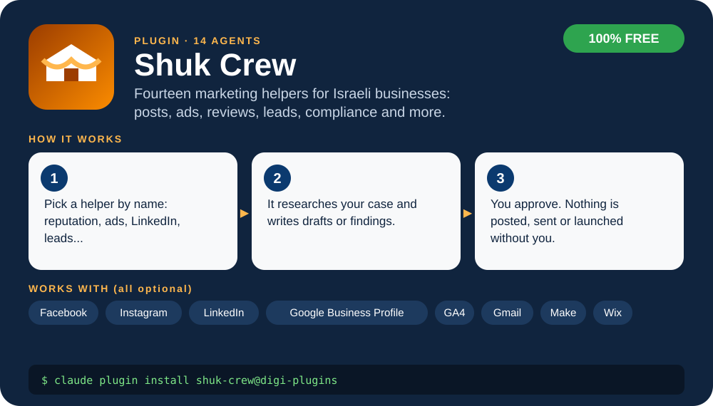
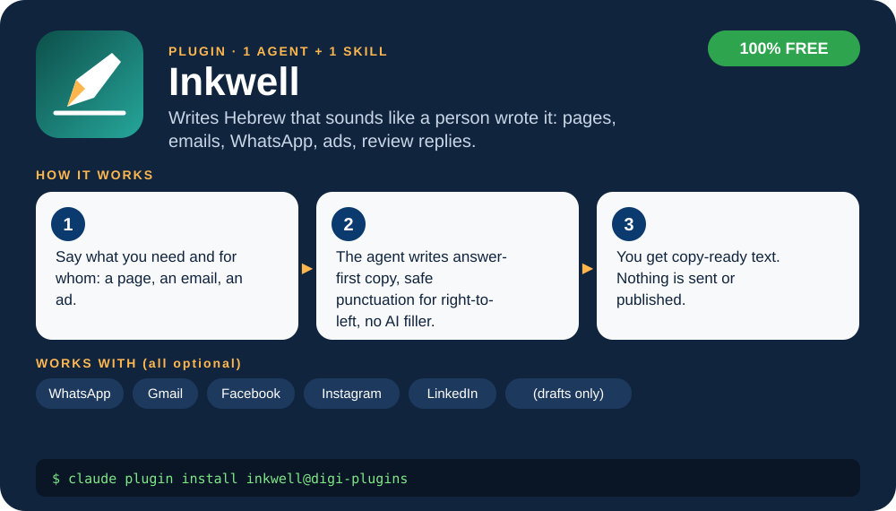

<p align="center"></p>

<div dir="rtl">

# Claude Code Plugin Atelier

   

**חמישה פלאגינים חינמיים שנותנים ל-Claude Code מומחים מוכנים: קידום אתרים, שיווק, כתיבה בעברית, ניתוב כלים ושדרוג תוכנה.** נבנו לעסקים קטנים ופרילנסרים, ונבדקו על אתרים ישראליים אמיתיים.

[English](README.md)

## ב-30 שניות

| | |
|---|---|
| **מה זה?** | תוספות ל-Claude Code. כל אחת מלמדת את Claude משימה: לבדוק אתר, לכתוב עברית, לתכנן מודעות, לשדרג אפליקציה. |
| **מחיר** | **חינם.** רישיון MIT, בלי חשבון, בלי מפתח API, בלי שירות בתשלום. |
| **זה בטוח?** | כברירת מחדל: קריאה וטיוטות בלבד. שום דבר לא נשלח, לא מתפרסם, לא נמחק ולא משולם בלי אישור שלך. |
| **צריך לדעת לתכנת?** | לא. מתקינים ב-2 פקודות ואז מדברים עם Claude בשפה רגילה. |



## התקנה (2 דקות)

**מה צריך:** [Claude Code](https://claude.com/claude-code) (האפליקציה של Anthropic, עם התוכנית שלה). הפלאגינים עצמם לא עולים כלום.

**שלב 1.** מוסיפים את המאגר (פעם אחת):

```bash
claude plugin marketplace add ofirshudari1-ship-it/digi-plugins
```

**שלב 2.** מתקינים את הפלאגין שרוצים (מחליפים את השם):

```bash
claude plugin install searchlight@digi-plugins
```

השמות: `searchlight`, `dispatch-desk`, `shuk-crew`, `inkwell`, `forge`.

**שלב 3.** פותחים סשן חדש של Claude Code וכותבים בשפה רגילה (דוגמאות למטה).

מעדיפים להקליד בתוך Claude Code? `/plugin marketplace add ofirshudari1-ship-it/digi-plugins` ואז `/plugin install searchlight@digi-plugins`.

## חמשת הפלאגינים

| פלאגין | במשפט אחד | התקנה |
|---|---|---|
| **[Searchlight](#searchlight)** | בודק למה האתר שלך לא מופיע בגוגל, ב-ChatGPT, ב-Gemini וב-Perplexity, ומחזיר רשימת תיקונים לפי חומרה. | `claude plugin install searchlight@digi-plugins` |
| **[Dispatch Desk](#dispatch-desk)** | מרכזייה: אומרת ל-Claude איזה כלי מטפל באיזו משימה, כדי שיפסיק לנחש. | `claude plugin install dispatch-desk@digi-plugins` |
| **[Shuk Crew](#shuk-crew)** | 14 עוזרי שיווק לעסקים בישראל: פוסטים, מודעות, ביקורות, לידים, ציות ועוד. | `claude plugin install shuk-crew@digi-plugins` |
| **[Inkwell](#inkwell)** | כותב עברית שנשמעת כמו אדם: דפי נחיתה, מיילים, וואטסאפ, מודעות ותגובות לביקורות. | `claude plugin install inkwell@digi-plugins` |
| **[Forge](#forge)** | משדרג אפליקציה או עמוד קיימים: עברית מימין לשמאל, מובייל, נגישות, מהירות ועיצוב. | `claude plugin install forge@digi-plugins` |

<a id="searchlight"></a>
### 1. Searchlight


**מה זה עושה:** בודק למה האתר שלך לא מופיע בגוגל, ב-ChatGPT, ב-Gemini וב-Perplexity, ומחזיר רשימת תיקונים לפי חומרה.

**איך זה עובד**

1. נותנים כתובת אתר.
2. סוכן ראשי שולח שישה מומחים: טכני, תוכן, קישורים, מקומי, נתונים, AI וסכמה.
3. מקבלים רשימת תיקונים לפי חומרה. שום דבר באתר לא משתנה.

**מתחבר ל (הכול אופציונלי):** Google Search Console, GA4, PageSpeed, Lighthouse, Wix, Ahrefs / Semrush (paid by them)

**אפשר לכתוב:** "בדוק את example.com ודרג את התיקונים לפי חומרה"

**התקנה:** `claude plugin install searchlight@digi-plugins`

**מה בפנים:** סוכן ראשי `seo-ultimate` ושישה מומחים (`dso-technical`, `dso-geo-schema`, `dso-content`, `dso-links`, `dso-local`, `dso-data`), סקריפטים לבדיקה ו-26 נהלים כתובים. ניתוח בלבד: אין לו כלי שיכול לערוך את האתר.

הגדרת מקורות נתונים חינמיים: [docs/SETUP-FREE-TOOLS.md](searchlight/docs/SETUP-FREE-TOOLS.md).

<a id="dispatch-desk"></a>
### 2. Dispatch Desk


**מה זה עושה:** מרכזייה: אומרת ל-Claude איזה כלי מטפל באיזו משימה, כדי שיפסיק לנחש.

**איך זה עובד**

1. מתארים משימה: פוסט, דוח, מודעה, סרטון.
2. נתב של התחום בוחר כלי אחד מנצח, לא שניים שחופפים.
3. Claude משתמש בכלי הזה, עם ההגדרות והאישורים הנכונים.

**מתחבר ל (הכול אופציונלי):** Make, Zapier, Canva, Figma, Gmail, WhatsApp, Wix, Composio

**אפשר לכתוב:** "איזה כלי מתאים לדוח שבועי?"

**התקנה:** `claude plugin install dispatch-desk@digi-plugins`

**מה בפנים:** 13 נתבים (תוכן, עיצוב, סושיאל, פרסום ומדידה, מוניטין ולידים, כלי פיתוח, וידאו, מסמכים, אוטומציה ונתונים, תיבת דואר, Wix, זיכרון, כלי MCP) ועוד סקיל אינדקס `ops-router`. קידום אתרים נמצא ב-Searchlight.

<a id="shuk-crew"></a>
### 3. Shuk Crew



**מה זה עושה:** 14 עוזרי שיווק לעסקים בישראל: פוסטים, מודעות, ביקורות, לידים, ציות ועוד.

**איך זה עובד**

1. בוחרים עוזר לפי שם: מוניטין, מודעות, לינקדאין, לידים...
2. הוא בודק את המקרה שלך וכותב טיוטות או ממצאים.
3. אתה מאשר. שום דבר לא מתפרסם, נשלח או עולה לאוויר בלי אישור.

**מתחבר ל (הכול אופציונלי):** Facebook, Instagram, LinkedIn, Google Business Profile, GA4, Gmail, Make, Wix

**אפשר לכתוב:** "תריץ את סוכן המוניטין על הביקורות שלנו בגוגל"

**התקנה:** `claude plugin install shuk-crew@digi-plugins`

| סוכן | מה הוא עושה | מתחבר ל |
|---|---|---|
| `social-media-agent` | מתכנן פייסבוק ואינסטגרם: יומן, פוסטים, סטוריז, רילס | Facebook, Instagram |
| `linkedin-agent` | פוסטים, קרוסלות, טיוטות פנייה וביקורת דף בלינקדאין | LinkedIn |
| `ads-agent` | מודעות גוגל ומטא: מילות מפתח, מבנה, טיוטות, CPA/ROAS. מתכנן בלבד, לא מפעיל | Google Ads, Meta Ads |
| `reputation-agent` | קורא ביקורות, מנסח תגובות, בודק את פרופיל העסק בגוגל | Google Business Profile |
| `cro-agent` | מוצא למה מבקרים לא הופכים ללידים: טפסים, כפתורים, משפך | GA4 |
| `ux-perf-agent` | בדיקת מהירות, מובייל ונגישות (ת"י 5568 / WCAG AA), לפני ואחרי | Lighthouse, PageSpeed |
| `compliance-il-agent` | בדיקות ציות לאתר בישראל: עוגיות (תיקון 13), הצהרת נגישות, מדיניות פרטיות. לא ייעוץ משפטי | none |
| `design-brief-agent` | הופך בקשה לבריף ויזואלי עם גדלים לכל ערוץ, ומכווץ תמונות מקומית | none |
| `email-agent` | ממיין תיבת דואר ומנסח תשובות. אף פעם לא שולח | Gmail or any mail tool |
| `lead-ops-agent` | בודק את הדרך מטופס באתר ל-CRM, זמן תגובה ראשונה, לידים שאבדו | Make, CRM |
| `analytics-agent` | דוח אחד על קידום, מודעות, סושיאל ולידים. קריאה בלבד | GA4, Search Console |
| `competitor-watch-agent` | עוקב אחרי אתרי מתחרים: שינויים, מחירים, שירותים חדשים, פערי תוכן | none |
| `directory-listing-agent` | מכין רישום בדירקטוריז חינמיים ורשימת בדיקה לכל אחד. לא פותח חשבונות | none |
| `wix-apps-agent` | בודק אפליקציות מותקנות ב-Wix: כפילויות, לא בשימוש, עלות, תקינות | Wix |

<a id="inkwell"></a>
### 4. Inkwell



**מה זה עושה:** כותב עברית שנשמעת כמו אדם: דפי נחיתה, מיילים, וואטסאפ, מודעות ותגובות לביקורות.

**איך זה עובד**

1. אומרים מה צריך ולמי: דף, מייל, מודעה.
2. הסוכן כותב טקסט שפותח בתשובה, עם פיסוק בטוח לעברית, בלי מילים ריקות של AI.
3. מקבלים טקסט מוכן להעתקה. שום דבר לא נשלח ולא מתפרסם.

**מתחבר ל (הכול אופציונלי):** WhatsApp, Gmail, Facebook, Instagram, LinkedIn, (drafts only)

**אפשר לכתוב:** "תכתוב סט כותרות לדף נחיתה בעברית"

**התקנה:** `claude plugin install inkwell@digi-plugins`

**מה בפנים:** סוכן הכתיבה `inkwell` והסקיל `hebrew-copy-style`: רשימת בדיקה קצרה עם דוגמאות לפני ואחרי, שאפשר להריץ על כל טקסט בעברית.

<a id="forge"></a>
### 5. Forge


**מה זה עושה:** משדרג אפליקציה או עמוד קיימים: עברית מימין לשמאל, מובייל, נגישות, מהירות ועיצוב.

**איך זה עובד**

1. סורק את האפליקציה ופותח אותה בדפדפן אמיתי.
2. מתכנן ספרינטים, מתקן, ועושה commit לכל ספרינט בענף git נפרד.
3. סוכן ספקן נפרד נותן ציון ב-10 מימדים, עם ראיות.

**מתחבר ל (הכול אופציונלי):** Playwright, Chrome DevTools, Python 3 (for the scanner), Git

**אפשר לכתוב:** "שדרג את אפליקציית ה-Electron הזו מקצה לקצה"

**התקנה:** `claude plugin install forge@digi-plugins`

**מה בפנים:** 4 סוכנים (`system-upgrader`, `upgrade-evaluator`, `page-upgrader`, `tool-standards-audit`) והסקיל `system-upgrade` עם סקריפט סריקה ומדריכי עזר. הסוכנים אף פעם לא עושים force-push.

## מה זה אומר "חינם"

- כל מה שבמאגר הזה **חינמי** ברישיון MIT, לשימוש אישי ומסחרי.
- צריך Claude Code, שיש לו תוכנית משלו אצל Anthropic. זה לא חלק מהמאגר.
- כמה מחברים **אופציונליים** (למשל Ahrefs, Semrush, DataForSEO) הם שירותים בתשלום של צד שלישי. אף פעם לא חייבים אותם: כל פלאגין עובד בלעדיהם, ול-Searchlight יש [מדריך להגדרת כלים חינמיים](searchlight/docs/SETUP-FREE-TOOLS.md).
- אם מקור נתונים לא מחובר, הפלאגין אומר את זה. הוא לא ממציא מספרים.

## פלאגין, סקיל, סוכן: מה ההבדל?

| מילה | משמעות |
|---|---|
| **פלאגין** | חבילה שמתקינים פעם אחת. יכולה להכיל סקילים וסוכנים. |
| **סקיל** | מדריך צעד-אחר-צעד ש-Claude מבצע בתוך השיחה שלך. |
| **סוכן** | עוזר שעובד לבד בסשן נפרד ומחזיר דוח. |

מצאתם בעיה או רוצים פיצ'ר? פתחו Issue.

## רישיון

MIT. חינם לשימוש אישי ומסחרי.

</div>
