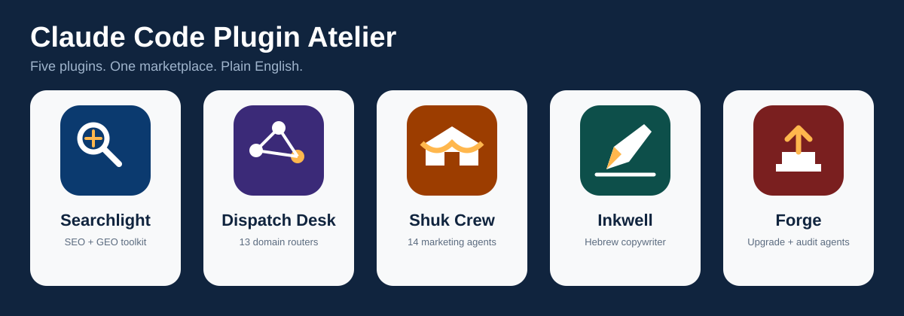

<p align="center"></p>

<div dir="rtl">

# Claude Code Plugin Atelier

**חמישה פלאגינים חינמיים שנותנים ל-Claude Code מומחים מוכנים: קידום אתרים, שיווק, כתיבה בעברית, ניתוב כלים ושדרוג תוכנה.** נבנו לעסקים קטנים ופרילנסרים, ונבדקו על אתרים ישראליים אמיתיים. רישיון MIT.

[English](README.md)

## למה כדאי להתקין
| בלי פלאגין | עם פלאגין |
|---|---|
| כותבים פרומפט ארוך בכל פעם ("בדוק את האתר, בדוק schema, בדוק בוטים של AI...") | משפט אחד. הפלאגין כבר מכיר את רשימת הבדיקות |
| Claude מנחש באיזה כלי להשתמש | נתב בוחר כלי אחד לכל משימה |
| טקסט בעברית נשמע כמו תרגום | מדריך סגנון לעברית טבעית ותקינה ב-RTL |
| סוכן עלול לפרסם או לשלוח | הכול **טיוטה וממצאים בלבד**. שום דבר לא נשלח, לא מתפרסם, לא נמחק ולא משולם בלי אישור שלך |

לא צריך חשבון, מפתח API או חיבור פרטי כדי להתחיל. חיבורים אופציונליים משפרים את התוצאות (ר' הטבלה).

## הפלאגינים
| פלאגין | מה הוא עושה בשפה פשוטה | מתחבר ל- (אופציונלי) | נסו לומר |
|---|---|---|---|
| **Searchlight** | בודק למה אתר לא מדורג בגוגל ולא מופיע ב-ChatGPT, Gemini ו-Perplexity, ומדרג תיקונים לפי חומרה. סוכן ראשי ושישה מומחים: טכני, תוכן, קישורים, מקומי, נתונים, AI ו-schema | Google Search Console, GA4, Lighthouse, PageSpeed, Ahrefs, Semrush, Wix | "בדוק את example.com ודרג את התיקונים לפי חומרה" |
| **Dispatch Desk** | מרכזיה. אומרת ל-Claude איזה כלי או סקיל מטפל בכל משימה (תוכן, עיצוב, סושיאל, פרסום, ביקורות, וידאו, מסמכים, אוטומציה, מייל, Wix) | Make, Zapier, Canva, Figma, Gmail, WhatsApp, Wix, Composio | "איזה כלי מטפל בדוח שבועי?" |
| **Shuk Crew** | 14 עוזרי שיווק לעסקים בישראל: פוסטים, LinkedIn, מודעות, תגובות לביקורות, המרות, נגישות (ת"י 5568), פרטיות (תיקון 13), לידים, מיון מייל, מתחרים, דירקטוריות | Facebook, Instagram, LinkedIn, Google Business Profile, GA4, Gmail, Make, Wix | "הפעל את סוכן המוניטין על הביקורות בגוגל" |
| **Inkwell** | כותב עברית שנשמעת אנושית: דפי נחיתה, מאמרים, מיילים, וואטסאפ, מודעות, תגובות לביקורות. נמנע ממילות מילוי בסגנון AI | WhatsApp, Gmail, רשתות חברתיות (טיוטות בלבד) | "כתוב סט כותרות בעברית לדף נחיתה" |
| **Forge** | משדרג אפליקציה או עמוד קיימים: סורק, מתכנן ספרינטים, מתקן RTL, מובייל, נגישות ומהירות, וסוכן שני נותן ציון ספקני | Playwright, Lighthouse | "שדרג את אפליקציית ה-Electron הזו מקצה לקצה" |

## התקנה (2 דקות)
```bash
claude plugin marketplace add ofirshudari1-ship-it/digi-plugins
```
```bash
claude plugin install searchlight@digi-plugins
```
במקום `searchlight` אפשר `dispatch-desk`, `shuk-crew`, `inkwell` או `forge`.

## טוב לדעת
- **פלאגין** מכיל סקילים, סוכנים וסקריפטים. **סקיל** הוא מדריך שלבים ש-Claude עוקב אחריו. **סוכן** הוא עוזר שעובד לבד ומחזיר דוח.
- בטוח מעיצוב: קריאה בלבד כברירת מחדל, ואישור לפני כל פעולה כלפי חוץ.
- הממצאים טובים כמו הנתונים. אם מקור (למשל Search Console) לא מחובר, הפלאגין אומר זאת ולא ממציא מספרים.
- מצאתם בעיה או רוצים יכולת חדשה? פתחו Issue.

## רישיון
MIT. חינם לשימוש אישי ומסחרי.

</div>
