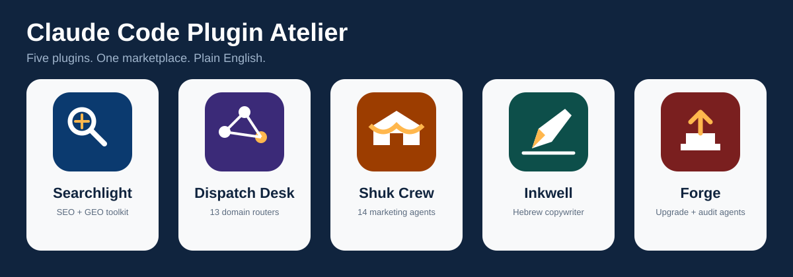
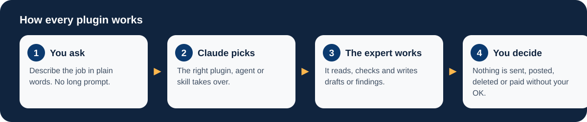
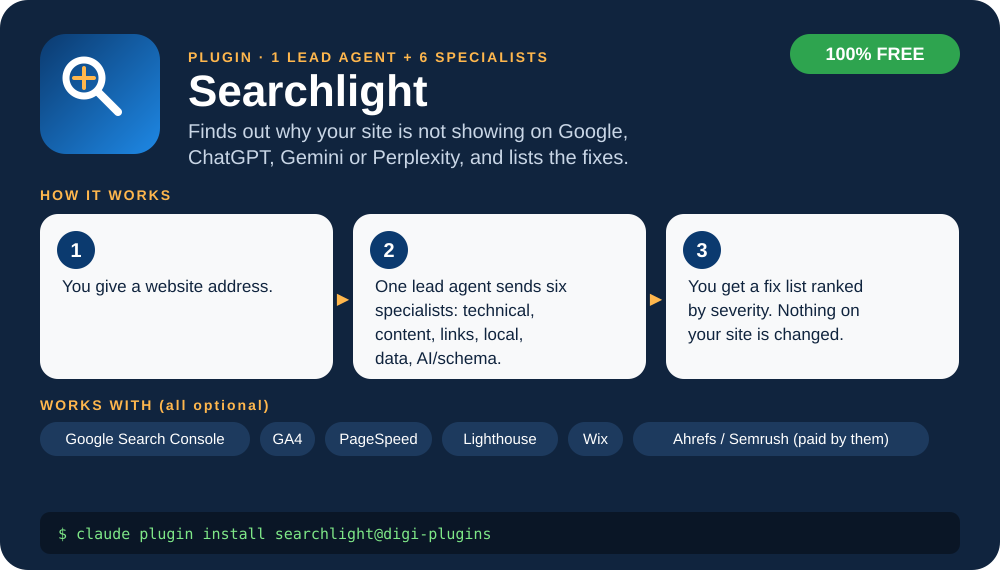
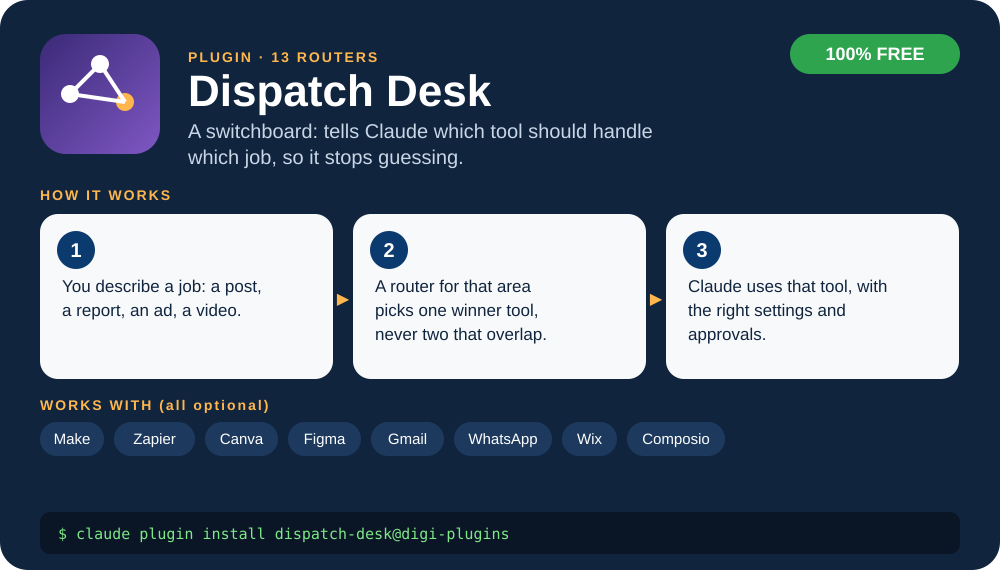
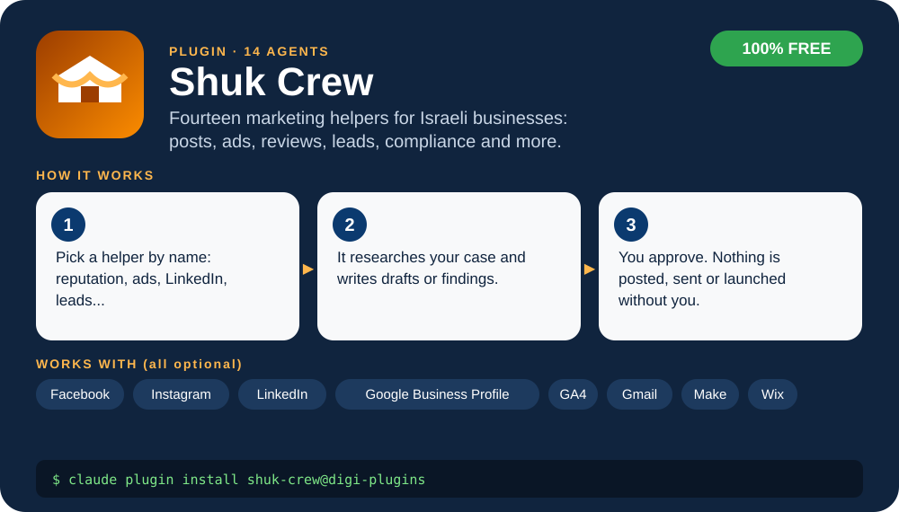
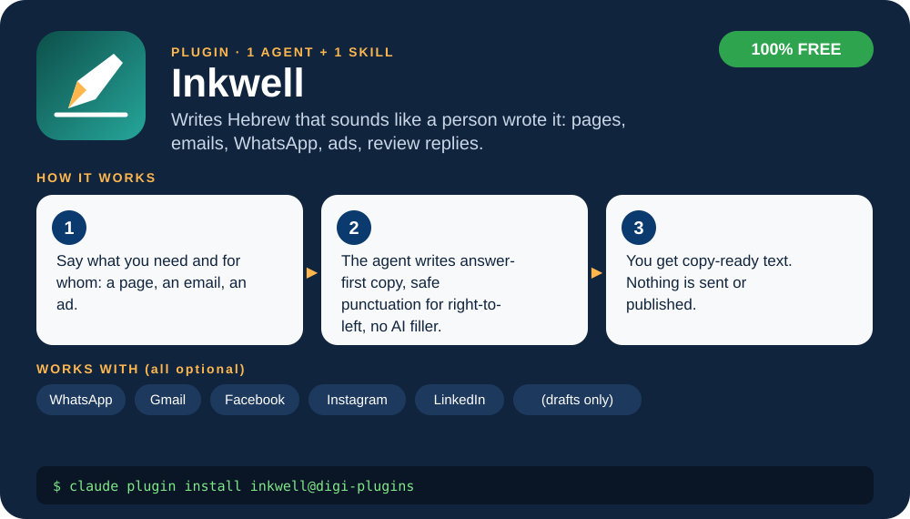
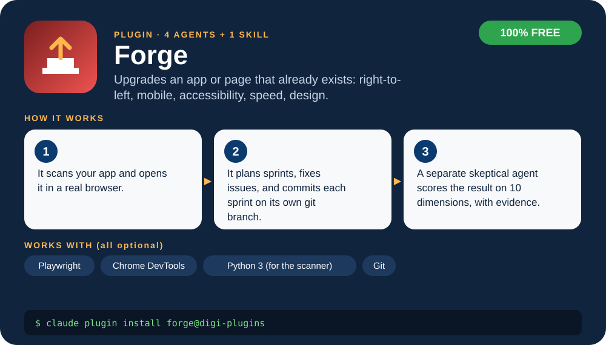

<p align="center"></p>

# Claude Code Plugin Atelier

   

**Five free plugins that give Claude Code ready-made experts for SEO, marketing, Hebrew writing, tool routing and software upgrades.** Built for small businesses and freelancers, tested on real Israeli sites.

[עברית](README.he.md)

## In 30 seconds

| | |
|---|---|
| **What is it?** | Add-ons for Claude Code. Each one teaches Claude a job: audit a site, write Hebrew, plan ads, upgrade an app. |
| **Price** | **Free.** MIT license, no account, no API key, no paid service needed. |
| **Is it safe?** | Read-only and draft-only by default. Nothing is sent, posted, deleted or paid without your approval. |
| **Do I need to code?** | No. You install with 2 commands, then talk to Claude in plain words. |



## Install (2 minutes)

**You need:** [Claude Code](https://claude.com/claude-code) (Anthropic's own app, with its own plan). The plugins themselves cost nothing.

**Step 1.** Add the marketplace (once):

```bash
claude plugin marketplace add ofirshudari1-ship-it/digi-plugins
```

**Step 2.** Install the plugin you want (replace the name):

```bash
claude plugin install searchlight@digi-plugins
```

Names: `searchlight`, `dispatch-desk`, `shuk-crew`, `inkwell`, `forge`.

**Step 3.** Start a new Claude Code session and ask in plain words (examples below).

Prefer typing inside Claude Code? Use `/plugin marketplace add ofirshudari1-ship-it/digi-plugins` then `/plugin install searchlight@digi-plugins`.

## The 5 plugins

| Plugin | In one line | Install |
|---|---|---|
| **[Searchlight](#searchlight)** | Finds out why your site is not showing on Google, ChatGPT, Gemini or Perplexity, and lists the fixes. | `claude plugin install searchlight@digi-plugins` |
| **[Dispatch Desk](#dispatch-desk)** | A switchboard: tells Claude which tool should handle which job, so it stops guessing. | `claude plugin install dispatch-desk@digi-plugins` |
| **[Shuk Crew](#shuk-crew)** | Fourteen marketing helpers for Israeli businesses: posts, ads, reviews, leads, compliance and more. | `claude plugin install shuk-crew@digi-plugins` |
| **[Inkwell](#inkwell)** | Writes Hebrew that sounds like a person wrote it: pages, emails, WhatsApp, ads, review replies. | `claude plugin install inkwell@digi-plugins` |
| **[Forge](#forge)** | Upgrades an app or page that already exists: right-to-left, mobile, accessibility, speed, design. | `claude plugin install forge@digi-plugins` |

<a id="searchlight"></a>
### 1. Searchlight



**What it does:** Finds out why your site is not showing on Google, ChatGPT, Gemini or Perplexity, and lists the fixes.

**How it works**

1. You give a website address.
2. One lead agent sends six specialists: technical, content, links, local, data, AI/schema.
3. You get a fix list ranked by severity. Nothing on your site is changed.

**Works with (all optional):** Google Search Console, GA4, PageSpeed, Lighthouse, Wix, Ahrefs / Semrush (paid by them)

**Try saying:** "Audit example.com and rank the fixes by severity"

**Install:** `claude plugin install searchlight@digi-plugins`

**Inside:** lead agent `seo-ultimate` + six specialists `dso-technical`, `dso-geo-schema`, `dso-content`, `dso-links`, `dso-local`, `dso-data`, plus audit scripts and 26 written procedures. Analysis only: it has no tool that can edit your site.

Free data sources setup: [docs/SETUP-FREE-TOOLS.md](searchlight/docs/SETUP-FREE-TOOLS.md).

<a id="dispatch-desk"></a>
### 2. Dispatch Desk



**What it does:** A switchboard: tells Claude which tool should handle which job, so it stops guessing.

**How it works**

1. You describe a job: a post, a report, an ad, a video.
2. A router for that area picks one winner tool, never two that overlap.
3. Claude uses that tool, with the right settings and approvals.

**Works with (all optional):** Make, Zapier, Canva, Figma, Gmail, WhatsApp, Wix, Composio

**Try saying:** "Which tool should handle a weekly report?"

**Install:** `claude plugin install dispatch-desk@digi-plugins`

**Inside:** 13 routers (content, design, social, ads and measurement, reputation and leads, dev toolchain, video, docs and office, automation and data, inbox, Wix, memory, MCP tools) plus one index skill `ops-router`. SEO lives in Searchlight.

<a id="shuk-crew"></a>
### 3. Shuk Crew



**What it does:** Fourteen marketing helpers for Israeli businesses: posts, ads, reviews, leads, compliance and more.

**How it works**

1. Pick a helper by name: reputation, ads, LinkedIn, leads...
2. It researches your case and writes drafts or findings.
3. You approve. Nothing is posted, sent or launched without you.

**Works with (all optional):** Facebook, Instagram, LinkedIn, Google Business Profile, GA4, Gmail, Make, Wix

**Try saying:** "Run the reputation agent on our Google reviews"

**Install:** `claude plugin install shuk-crew@digi-plugins`

| Agent | What it does | Works with |
|---|---|---|
| `social-media-agent` | Plans Facebook and Instagram: calendar, posts, Stories, Reels | Facebook, Instagram |
| `linkedin-agent` | LinkedIn posts, carousels, outreach drafts, page audit | LinkedIn |
| `ads-agent` | Google and Meta ads: keywords, structure, ad drafts, CPA/ROAS. Plans only, never launches | Google Ads, Meta Ads |
| `reputation-agent` | Reads your reviews, drafts replies, audits Google Business Profile | Google Business Profile |
| `cro-agent` | Finds why visitors do not become leads: forms, buttons, funnel | GA4 |
| `ux-perf-agent` | Speed, mobile and accessibility (IS 5568 / WCAG AA) audit, before and after | Lighthouse, PageSpeed |
| `compliance-il-agent` | Israeli web checks: cookie consent (Amendment 13), accessibility statement, privacy policy. Not legal advice | none |
| `design-brief-agent` | Turns a request into a visual brief with sizes per channel, shrinks images locally | none |
| `email-agent` | Sorts the inbox and drafts replies. Never sends | Gmail or any mail tool |
| `lead-ops-agent` | Checks the path from website form to CRM, first-response time, lost leads | Make, CRM |
| `analytics-agent` | One report across SEO, ads, social and leads. Read-only | GA4, Search Console |
| `competitor-watch-agent` | Watches competitor sites: changes, prices, new services, content gaps | none |
| `directory-listing-agent` | Prepares free directory listings and a checklist per directory. Creates no accounts | none |
| `wix-apps-agent` | Audits installed Wix apps: duplicates, unused, cost, health | Wix |

<a id="inkwell"></a>
### 4. Inkwell



**What it does:** Writes Hebrew that sounds like a person wrote it: pages, emails, WhatsApp, ads, review replies.

**How it works**

1. Say what you need and for whom: a page, an email, an ad.
2. The agent writes answer-first copy, safe punctuation for right-to-left, no AI filler.
3. You get copy-ready text. Nothing is sent or published.

**Works with (all optional):** WhatsApp, Gmail, Facebook, Instagram, LinkedIn, (drafts only)

**Try saying:** "Write a set of landing page headlines in Hebrew"

**Install:** `claude plugin install inkwell@digi-plugins`

**Inside:** the `inkwell` writing agent and the `hebrew-copy-style` skill, a quick style checklist with before/after examples you can run over any Hebrew text.

<a id="forge"></a>
### 5. Forge



**What it does:** Upgrades an app or page that already exists: right-to-left, mobile, accessibility, speed, design.

**How it works**

1. It scans your app and opens it in a real browser.
2. It plans sprints, fixes issues, and commits each sprint on its own git branch.
3. A separate skeptical agent scores the result on 10 dimensions, with evidence.

**Works with (all optional):** Playwright, Chrome DevTools, Python 3 (for the scanner), Git

**Try saying:** "Upgrade this Electron app end to end"

**Install:** `claude plugin install forge@digi-plugins`

**Inside:** 4 agents `system-upgrader`, `upgrade-evaluator`, `page-upgrader`, `tool-standards-audit` and the `system-upgrade` skill with a scanner script and reference guides. Agents never force-push.

## What "free" means

- Everything in this repo is **free** under the MIT license, for personal and commercial use.
- You need Claude Code, which has its own Anthropic plan. That is not part of this repo.
- A few **optional** connectors (for example Ahrefs, Semrush, DataForSEO) are third-party paid services. You never need them: every plugin works without them, and Searchlight has a [free tools setup guide](searchlight/docs/SETUP-FREE-TOOLS.md).
- If a data source is not connected, the plugin says so. It does not invent numbers.

## Plugin, skill, agent: what is the difference?

| Word | Meaning |
|---|---|
| **Plugin** | A package you install once. It can hold skills and agents. |
| **Skill** | A step-by-step playbook Claude follows inside your chat. |
| **Agent** | A helper that works on its own in a separate session and sends back a report. |

Found a problem or want a feature? Open an issue.

## License

MIT. Free for personal and commercial use.
